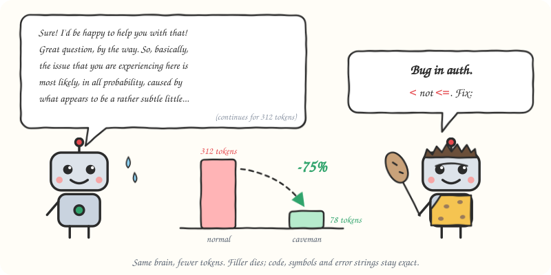
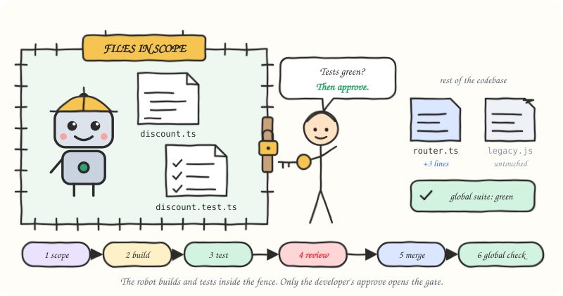
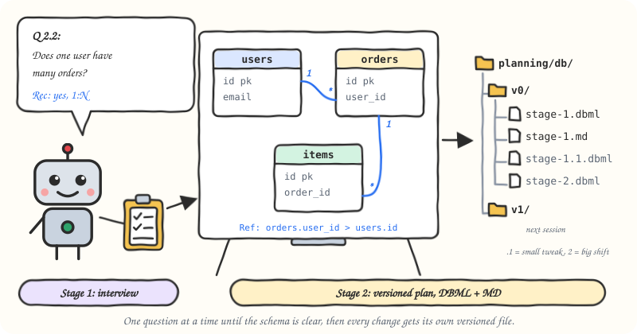

# Agent Skills

This repository is the central home for my agent skills. It keeps reusable instructions and supporting files in one place so I can maintain, share, and use them across agents and projects.

Each skill is a folder with a `SKILL.md` (the instructions your agent loads) and, for most of them, a `README.md` (the guide for humans, with sketches). They work with Claude Code, Codex, Cursor, GitHub Copilot, Gemini CLI and any other agent that reads `SKILL.md` files.


## Install

The recommended way is the open [`skills`](https://github.com/vercel-labs/skills) installer. Run it from your project and it asks which agents to install for:

```bash
npx skills add SinghChinmayy/agent-skills --all
```

Just one skill:

```bash
npx skills add SinghChinmayy/agent-skills --skill tdd-red-green-refactor
```

Useful flags: `-g` installs for all your projects instead of the current one, `-a claude-code` picks the agent, `-y` skips the prompts, and `--list` shows what is in this repo without installing anything.

No Node? Copy a skill's `SKILL.md` into `~/.claude/skills/<name>/` for Claude Code, or `~/.agents/skills/<name>/` for Codex and most other agents. Each skill's README has the exact one-line `curl` command.

## Skills

| Skill | What it does | Say |
| --- | --- | --- |
| [tdd-red-green-refactor](skills/engineering/tdd-red-green-refactor/) | One behaviour at a time, with separate red, green and optional refactor commits, so the history proves the tests came first. Any language. | "tdd", "test first" |
| [modular-development](skills/engineering/modular-development/) | Locks the agent to the files you declare, with a review gate you control before anything is merged. | "modular dev", "/modular" |
| [grill-me](skills/planning/grill-me/) | A one-question-at-a-time interview about your plan, with a recommended answer for every question. | "grill me" |
| [db-planning](skills/planning/db-planning/) | Interview, then versioned DBML and markdown database plans under `planning/db/`. | "plan db", "design database" |
| [engineering-notes](skills/learning/engineering-notes/) | Turns notebook photos and Markdown into continuous, topic-wise notes with revision questions and diagrams only when they help, ready to publish. | "process my notes" |
| [caveman](skills/productivity/caveman/) | Terse replies that keep every technical detail and cut output tokens by about 75%. | "caveman mode", "be brief" |
| [og-generator](skills/frontend/og-generator/) | Generates Open Graph images with headless Chrome from two HTML templates. Written for one of my sites, so expect to adapt it. | "generate OG images" |

| | |
| --- | --- |
|  |  |
|  |  |

## Layout

```text
skills/
  engineering/   tdd-red-green-refactor, modular-development
  planning/      grill-me, db-planning
  learning/      engineering-notes
  productivity/  caveman
  frontend/      og-generator
install.sh       legacy: appends every SKILL.md to ~/.claude/CLAUDE.md
```

`./install.sh` still works from a clone (`./install.sh --dry-run` to preview), but it inlines the skills into `CLAUDE.md` instead of installing them as real skills, so prefer `npx skills add`.

## More

- [Agent Skills on my website](https://chinmaysingh.me/agent-skills): every skill with its sketch and install command.
- [Red, Green, Robot: How I Build Software with AI Agents Now](https://chinmaysingh.me/blogs/ai-assisted-tdd-workflow): the workflow these skills came from, built on a real full-stack project.
