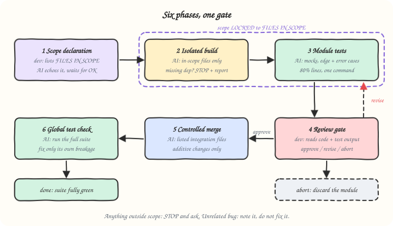

# modular-development

Build inside a fence. Merge only when the developer hands over the key.


## What it does

Locks the agent to an explicit list of files and walks every change through six phases: declare scope, build, test, review, merge, global check. The agent never edits a file outside the declared scope, never merges without an explicit `approve`, and never "cleans up" unrelated code it happens to see. Bugs found elsewhere get noted, not fixed.

## When to use it

Say "modular dev", "modular mode", "scoped build", "isolated module", or `/modular`. Handy when the codebase is large or fragile and you want a new piece of logic built and proven in isolation before it touches anything else.

| Command | Effect |
|---------|--------|
| `/modular start` | Begin phase 1: the agent asks for the scope declaration |
| `/modular scope` | Echo the current scope lock |
| `/modular status` | Show current phase and the next required action |
| `/modular expand <files>` | Add files to scope mid-session |
| `/modular approve` | Pass the current gate (phase 4 or 6) |
| `/modular revise <feedback>` | Loop back within the current phase |
| `/modular abort` | Discard the module work and reset scope |
| `/modular done` | Close out with a short completion summary |

## How it works



1. **Scope declaration** (you): name the module, the files in scope, the goal, and the entry point. The agent echoes it back and waits for OK.
2. **Isolated build** (agent): code only in the in-scope files. Missing dependency? Stop and report.
3. **Module tests** (agent): tests next to the module, external dependencies mocked, happy path plus edge and error cases, one command to run them. Target 80% lines, 100% of exported functions.
4. **Review gate** (you): the agent shows a summary, the changed files, test output, known limitations, and the proposed integration point, then waits for `approve`, `revise: <feedback>`, or `abort`.
5. **Controlled merge** (agent): wire the module in through the integration files you list. Additive changes only.
6. **Global test check** (agent): run the full suite, fix only breakage caused by the new module, and run it again until it is green.

## Install

Recommended: the open [`skills`](https://github.com/vercel-labs/skills) installer. Works with Claude Code, Codex, Cursor, GitHub Copilot, Gemini CLI and most other agents, and asks which ones to install for. Run it from your project:

```bash
npx skills add SinghChinmayy/agent-skills --skill modular-development
```

Add `-g` to install it for all your projects. To skip the prompts and install straight into Claude Code:

```bash
npx skills add SinghChinmayy/agent-skills --skill modular-development -g -a claude-code -y
```

No Node? A skill is just a folder with a `SKILL.md`. For Claude Code:

```bash
mkdir -p ~/.claude/skills/modular-development && curl -fsSL https://raw.githubusercontent.com/SinghChinmayy/agent-skills/main/skills/engineering/modular-development/SKILL.md -o ~/.claude/skills/modular-development/SKILL.md
```

For Codex and other agents that read `~/.agents/skills/`, swap the folder for `~/.agents/skills/modular-development`.

## Example

```text
You:   /modular start
Agent: Modular Development mode active. Scope is LOCKED until you declare files.
You:   MODULE: discount
       FILES IN SCOPE: src/cart/discount.ts, src/cart/discount.test.ts
       GOAL: apply percentage and fixed-amount coupons to a cart total
       ENTRY: applyDiscount()
Agent: Scope echoed back. Confirm?
You:   yes
Agent: (builds, writes tests, pastes 14 passing)
       Phase 4 review: 4 bullets, 2 files, test output, integration point: src/cart/router.ts
You:   /modular approve, integration files: src/cart/router.ts
Agent: router.ts +3 lines. Full suite: 312 passed.
```

```
MODULAR DEV STATUS
==================
Module:   discount
Phase:    4 / Review gate
Scope:    src/cart/discount.ts, src/cart/discount.test.ts
Pending:  developer approve / revise / abort
Gate:     WAITING FOR DEV
```

## Files

- [`SKILL.md`](./SKILL.md): full LLM-facing instructions
- [`assets/`](./assets/): the sketch and the phase diagram above
