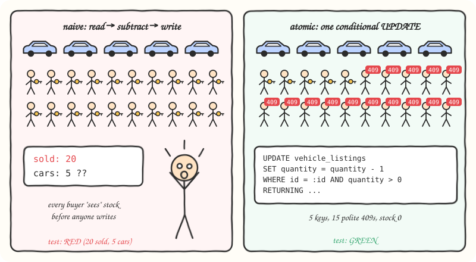
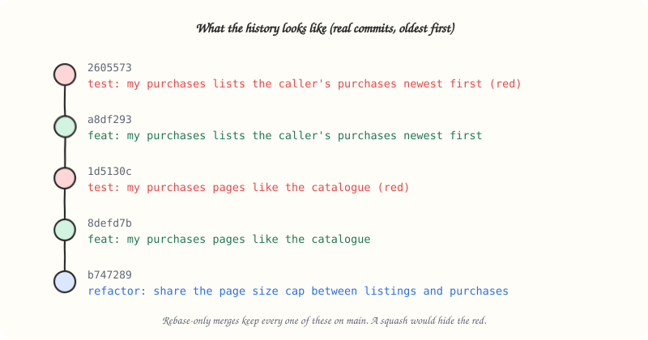

# tdd-red-green-refactor

Test first, one behavior at a time, with git history as proof.


## What it does

Makes the agent build features and bug fixes through strict red-green-refactor cycles, each phase its own commit. Works with any language or framework: the agent discovers the project's test runner and coverage command instead of assuming one.

Core rules:

| Phase | Commit | Rule |
|-------|--------|------|
| Red | `test: <behavior> (red)` | One test, fails on an assertion (not an import error) |
| Green | `feat:` / `fix:` | Minimum code to pass, full suite green, migrations go here |
| Refactor | `refactor:` | Optional, behavior unchanged, full suite green |

Also covers: planning the slice before coding, guard tests for rules the framework already enforces, an honest pattern for proving race-condition fixes, a no-squash merge policy, and AI co-author trailers.

## When to use it

Say "tdd", "red green refactor", "test first", "write the test first", or "implement with tests" when asking for a feature or bug fix.

## How it works

1. **Plan the slice.** List the behaviors as one-line test names, ordered: foundations (`chore:`), core rules, edge cases and errors, UI, end-to-end last.
2. **Red.** Write one failing test, run it, and confirm it fails for the intended reason. Commit.
3. **Green.** Write the smallest code that passes, run the full suite, commit.
4. **Refactor** if anything is worth cleaning, suite still green. Commit.
5. **Repeat** for the next behavior. Never squash, reorder, or rewrite history.

Shared-state writes (stock counts, balances, seat bookings) get an honest race test: fire N concurrent actors at a limited resource, commit the naive read-modify-write and watch it oversell, then fix it with one atomic write.



## Install

Recommended: the open [`skills`](https://github.com/vercel-labs/skills) installer. Works with Claude Code, Codex, Cursor, GitHub Copilot, Gemini CLI and most other agents, and asks which ones to install for. Run it from your project:

```bash
npx skills add SinghChinmayy/agent-skills --skill tdd-red-green-refactor
```

Add `-g` to install it for all your projects. To skip the prompts and install straight into Claude Code:

```bash
npx skills add SinghChinmayy/agent-skills --skill tdd-red-green-refactor -g -a claude-code -y
```

No Node? A skill is just a folder with a `SKILL.md`. For Claude Code:

```bash
mkdir -p ~/.claude/skills/tdd-red-green-refactor && curl -fsSL https://raw.githubusercontent.com/SinghChinmayy/agent-skills/main/skills/engineering/tdd-red-green-refactor/SKILL.md -o ~/.claude/skills/tdd-red-green-refactor/SKILL.md
```

For Codex and other agents that read `~/.agents/skills/`, swap the folder for `~/.agents/skills/tdd-red-green-refactor`.

Already cloned this repo? `./install.sh` appends every skill to your global `CLAUDE.md` instead (`./install.sh --dry-run` previews it).

## Example

```text
test: registering a duplicate email returns 409 (red)
feat: return 409 on duplicate email
refactor: extract email normalization helper
```

A whole feature reads as pairs of red and green commits, so anyone can check that each test came before its code:



## Files

- [`SKILL.md`](./SKILL.md): full LLM-facing instructions
- [`assets/`](./assets/): the sketches above
