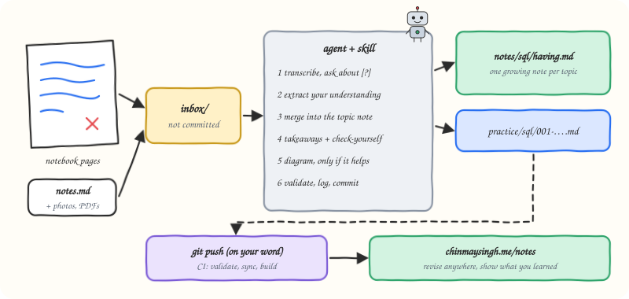

# engineering-notes

Turn notebook pages into notes you can revise from and publish.



## What it does

You study the way you already do: a paper notebook, a quick Markdown file. Drop photos, PDFs or `.md` files into `inbox/` and say "process my notes". The agent:

1. **Transcribes** handwriting faithfully, and asks about the words it can't read instead of guessing them.
2. **Extracts the essence**: the concepts, *your* analogies and mental models, examples, mistakes and doubts.
3. **Merges** it into one continuous note per topic (`notes/<subject>/<topic>.md`), so a new page on joins extends the joins note instead of starting another one.
4. **Corrects visibly**: wrong claims stay with a clear *Correction*, which is better for revision than a silent rewrite.
5. **Adds a revision block** to every note: key takeaways and self-check questions with hidden answers.
6. **Draws a diagram only when it earns its place** (an order, a structure, states, a comparison), in a friendly hand-drawn style.
7. **Validates, logs and commits.** It never pushes on its own, because pushing publishes.

Raw inputs are never committed, so your notebook stays private. Only the distilled notes are published.

## When to use it

Say "process my notes", "process the inbox", "digest my notes", "add this to my notes" or "write up what I learned".

## How it works

| Piece | Where |
| --- | --- |
| The workflow and its rules | [`SKILL.md`](SKILL.md) |
| Note and practice templates | [`references/note-template.md`](references/note-template.md) |
| When to draw, and how | [`references/diagram-style.md`](references/diagram-style.md) |
| Diagram helper (boxes, arrows, a robot) | [`scripts/sketch.py`](scripts/sketch.py) |

The skill expects a notes repository with `inbox/`, `notes/`, `practice/`, `log.md` and a `scripts/check_notes.py` validator. [SinghChinmayy/Engineering-Notes](https://github.com/SinghChinmayy/Engineering-Notes) is a working example, including the GitHub Action that publishes notes to a website.

## Install

Recommended: the open [`skills`](https://github.com/vercel-labs/skills) installer. Works with Claude Code, Codex, Cursor, GitHub Copilot, Gemini CLI and most other agents. Run it from your notes repository:

```bash
npx skills add SinghChinmayy/agent-skills --skill engineering-notes
```

Add `-g` to install it for all your projects. To skip the prompts and install straight into Claude Code:

```bash
npx skills add SinghChinmayy/agent-skills --skill engineering-notes -g -a claude-code -y
```

The skill ships with reference files and a script, so use the installer rather than copying `SKILL.md` alone.

## Example

```text
you:   process my notes
agent: Found 3 inputs: IMG_2041.jpg, IMG_2042.jpg, joins.md.
       One word on IMG_2042 is unclear: "a [?] join keeps unmatched rows
       from both sides". Is it "full outer"?
you:   yes
agent: Updated notes/sql/joins.md (new: FULL OUTER JOIN, a corrected
       claim about NULL matching, 2 new check-yourself questions, a Venn
       sketch). Added practice/sql/003-second-highest-salary.md.
       Committed "notes(sql): outer joins and NULL matching". Push to publish?
```

## Files

```text
engineering-notes/
├── SKILL.md
├── README.md
├── assets/engineering-notes-flow.svg
├── references/note-template.md
├── references/diagram-style.md
└── scripts/sketch.py
```
