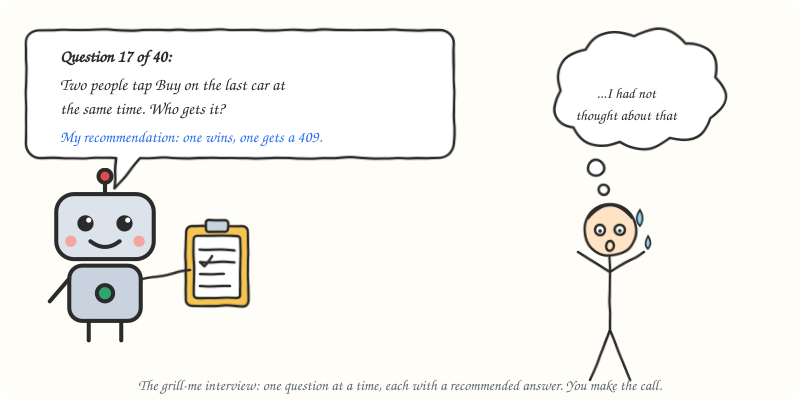

# grill-me

Get interviewed about your plan until there is nothing left to guess.



## What it does

Turns the agent into a relentless, friendly interviewer. It walks every branch of your plan or design, resolving decisions in dependency order, one question at a time. Each question comes with the agent's recommended answer, so you can accept it in one word or push back. If the codebase already answers a question, the agent goes and reads the code instead of asking you.

## When to use it

Say "grill me", or ask to stress-test a plan or get grilled on a design. Best right before you write code or a spec: the cheapest place to find the edge case you had not thought about.

## How it works

1. **Start at the root** of the design tree: what the plan is for.
2. **Ask one question**, with a recommended answer. Wait for yours.
3. **Go depth-first**: settle a decision before the questions that depend on it.
4. **Check the code first**: anything discoverable in the repo is looked up, not asked.
5. **Stop at shared understanding**, when every branch has a decision.

## Install

Recommended: the open [`skills`](https://github.com/vercel-labs/skills) installer. Works with Claude Code, Codex, Cursor, GitHub Copilot, Gemini CLI and most other agents, and asks which ones to install for. Run it from your project:

```bash
npx skills add SinghChinmayy/agent-skills --skill grill-me
```

Add `-g` to install it for all your projects. To skip the prompts and install straight into Claude Code:

```bash
npx skills add SinghChinmayy/agent-skills --skill grill-me -g -a claude-code -y
```

No Node? A skill is just a folder with a `SKILL.md`. For Claude Code:

```bash
mkdir -p ~/.claude/skills/grill-me && curl -fsSL https://raw.githubusercontent.com/SinghChinmayy/agent-skills/main/skills/planning/grill-me/SKILL.md -o ~/.claude/skills/grill-me/SKILL.md
```

For Codex and other agents that read `~/.agents/skills/`, swap the folder for `~/.agents/skills/grill-me`.

## Example

```text
You:   grill me on the checkout flow
Agent: Q1: Can a guest buy, or only signed-in users?
       Recommended: signed-in only, so purchase history has an owner.
You:   agreed
Agent: Q2: Two people tap Buy on the last car at the same time. Who gets it?
       Recommended: the first committed write wins; the other gets a 409.
You:   ...I had not thought about that. Yes, 409.
```

## Files

- [`SKILL.md`](./SKILL.md): full LLM-facing instructions
- [`assets/grill-me.svg`](./assets/grill-me.svg): the sketch above
